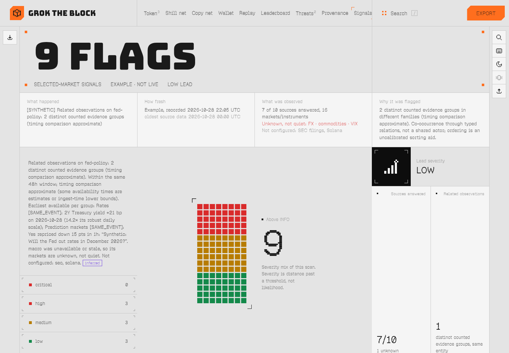
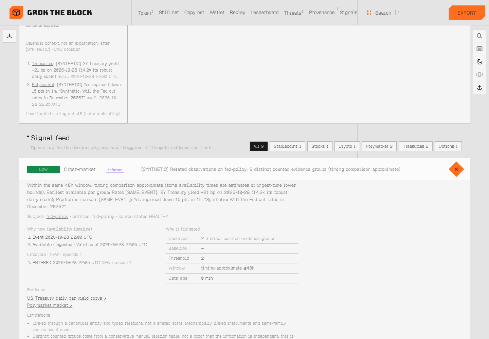
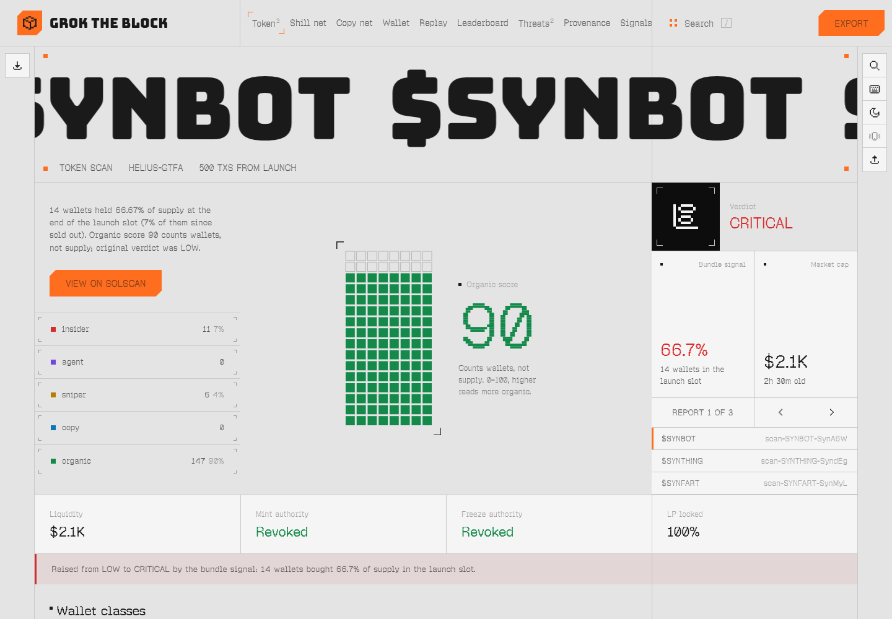
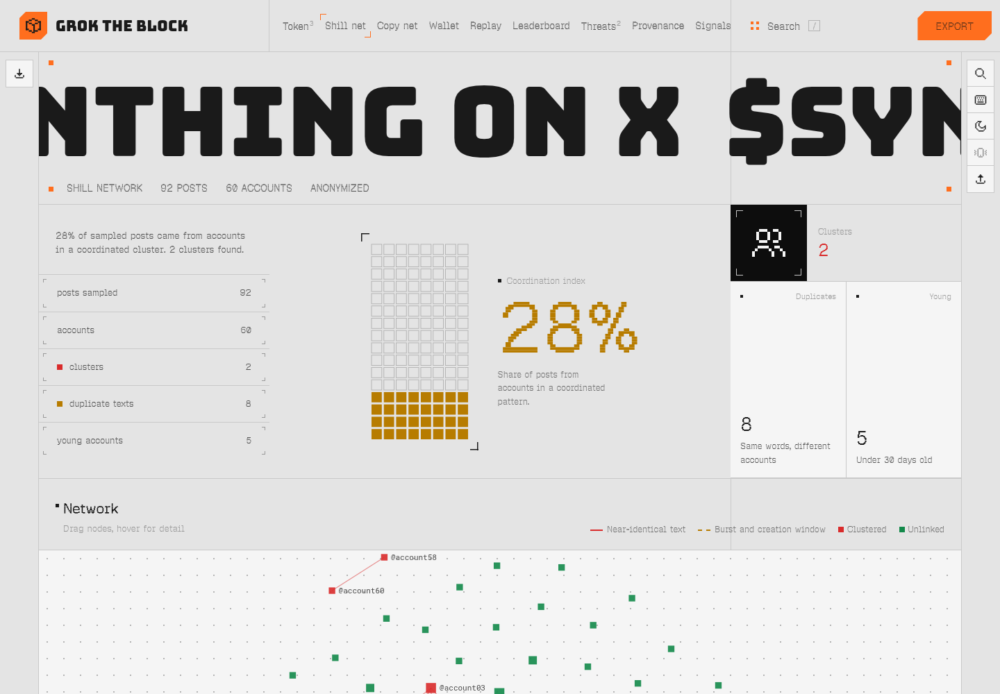
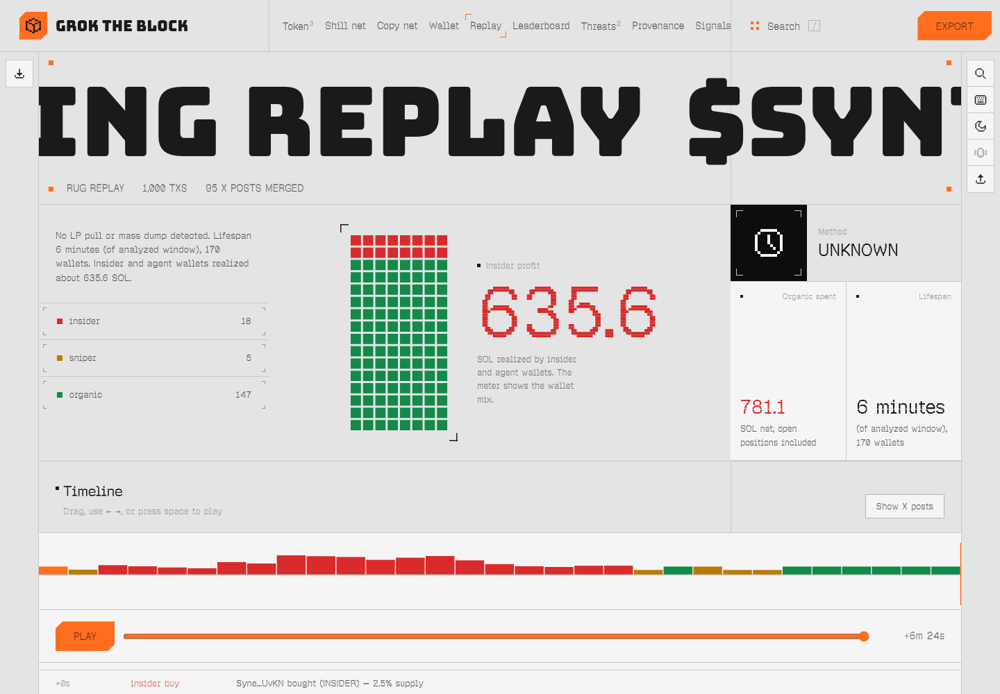
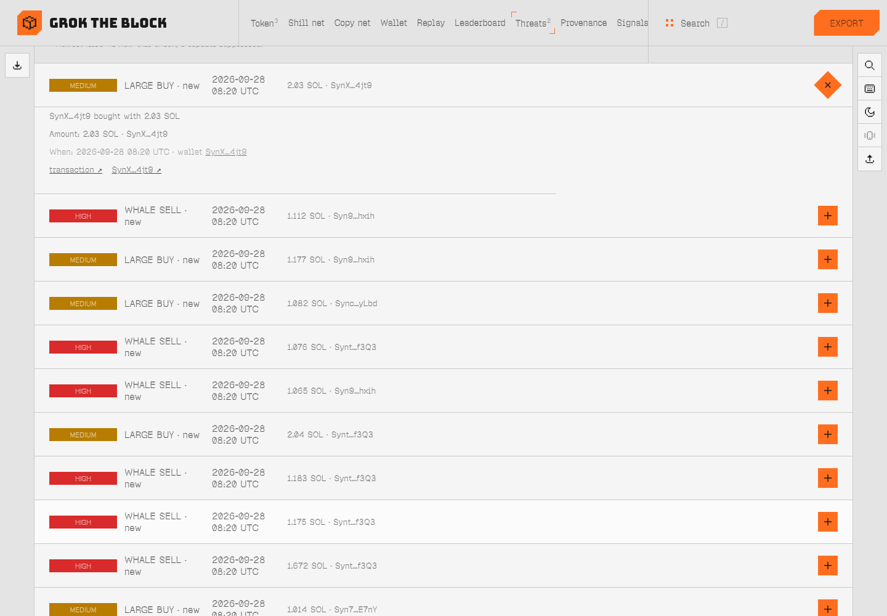
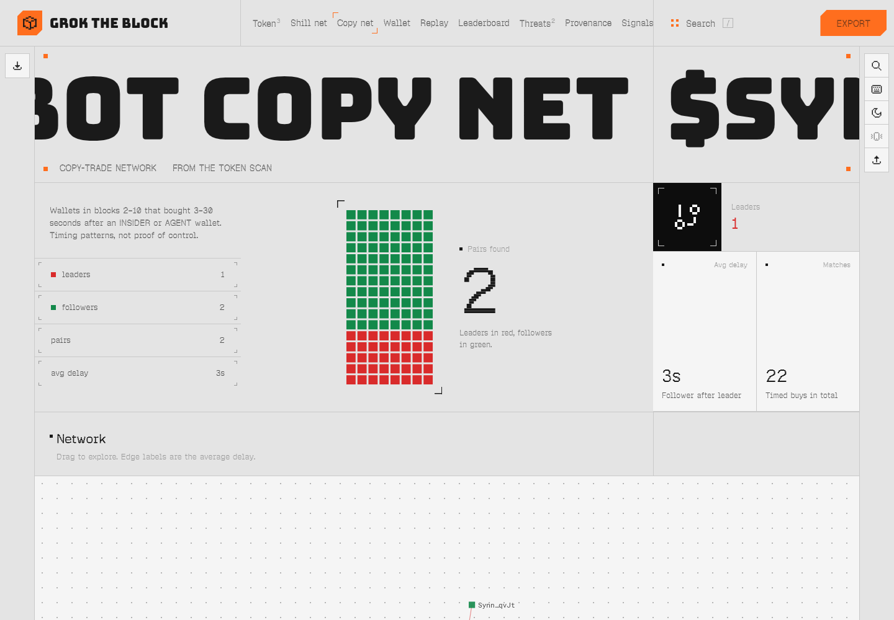
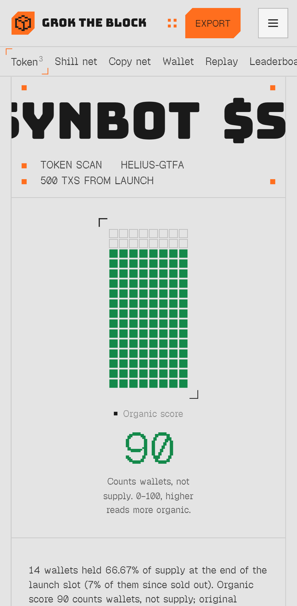

# Grok The Block

**Unusual-activity analysis across selected public markets, with the evidence behind every flag.** Grok The Block reads selected markets across multiple asset classes — Polymarket (including on-chain trade links), Kalshi, a configured list of US stocks and options, the Treasury curve, BTC/ETH/SOL on OKX, large stablecoins' aggregate supply, a few FX/commodity/volatility series, SEC filings (opt-in), and your own Solana watch reports. At the next observation or scan, subject to each provider's latency, it explains in plain English what looks unusual compared with that market's available historical or rule-based baseline, what it was compared against, and what the data can't show. When independent evidence groups in different causal families move on the same canonical entity through a typed relation (same underlying, same event or direct proxy), it lists them as **related observations** with the timeline, the evidence, and what was excluded; the ranking is an uncalibrated sorting aid. It never says who traded or claims wrongdoing. It is not a prediction: no historical hit rate or lead time has been measured.

By default you run it yourself, locally or on your own Grok Bot, for your own analysis. It is not a central broadcast feed: provider display and redistribution rights are unverified (see [docs/PROVIDER-RIGHTS.md](docs/PROVIDER-RIGHTS.md)).

> **Not financial advice.** Grok The Block flags unusual activity in public data and shows the evidence behind it. A signal is not a prediction, a recommendation to buy or sell, or an accusation against anyone. It never trades.

It started as a forensic tool for Solana tokens, and that's still here: give Grok Bot a token, a wallet, a ticker, or a promo clip, and it explains the transactions — who bought at launch, whether supply was bundled, who sold into whom, which wallets copy each other, whether promo accounts on X moved together, and what changed since you last looked. Each answer leads with the main finding, then its coverage and limits, the linked evidence, and what to check next. Results appear as a Page and in a local dashboard.

Grok The Block is an evolution of **[CryptOSINT](https://github.com/outerheaven199X/CryptOSINT) by Nikki ([@varien](https://x.com/varien))**. The original runs on Vite/React, Cloudflare Functions, KV, and paid Helius. This version runs on free public data (Helius optional). It adds plain-English assessments, the cross-market signal feed, X coordination checks, promo provenance, and watch diffs.

## Cross-market signals

`skills/signals` (`signals.py scan | watch`) → `out/signals-*.json` → the **Signals** tab (key `9`).

| Source | Keyless data used (latency) | Detectors (review shadow-mode defaults) |
|---|---|---|
| Polymarket | Gamma (markets), CLOB price history, data-api (trades); trades settle on Polygon (polled per scan) | ODDS_REPRICING (≥8 pts/15m or ≥12 pts/1h, ≥3× event volatility), VOLUME_SPIKE (≥4× prior 6 days), NEWLY_OBSERVED_ADDRESS_ACTIVITY (address newly observed on Polymarket within available history, ≥$25K) |
| Kalshi | public trade API v2 (per scan) | ODDS_REPRICING on executable midpoint vs previous day (limited), lifetime-volume spikes (context, capped LOW) |
| US stocks | Yahoo chart API, Nasdaq fallback (daily bars) | VOLUME_ROBUST_Z (60-session MAD, ≥3 and ≥1.8× median), RETURN_VS_REALIZED_VOL (≥3× 20-day vol) |
| US options | Cboe delayed chains, Nasdaq fallback (~15 min delayed) | UNUSUAL_OPTIONS_VOLUME (limited) and a separate conservative SHORT_DATED_OPTIONS (0/1DTE). Contracts without a parsed expiry are rejected and counted |
| Treasuries | Treasury.gov par curve, FRED fallback (daily, end of day) | YIELD_MOVE (max(8 bp, 2.5× robust scale)), CURVE_SHIFT with bull/bear steepening/flattening, persistent CURVE_INVERSION |
| Crypto | OKX spot + perps, Coinbase spot fallback (daily / per scan) | spot return/volume, OI_SHOCK (contracts and USD), FUNDING_EXTREME (normalized to 8h) |
| Stablecoins | DefiLlama aggregate supply (daily) | SUPPLY_CHANGE (≥$250M and ≥0.5%; HIGH ≥$1B), not mint/burn transactions |
| FX · commodities · vol | Yahoo (VIX, DXY, gold, WTI, EUR/USD, USD/JPY) (daily) | return vs realized vol, volume robust z |
| SEC EDGAR | atom feed + Form 4 XML (opt-in `GTB_SEC_USER_AGENT="Name email"`) | REPORTED_OPEN_MARKET_PURCHASES / REPORTED_SALES_CLUSTER (parsed transaction codes, unique reporting persons, amendments not double-counted, missing prices reported), material 8-K items |
| Solana | your local `watch-token` reports | whale sells, flagged wallet moves, LP changes |
| **Cross-market** | the above | CONVERGENCE (≥2 independent evidence groups via typed relations SAME_UNDERLYING / SAME_EVENT / DIRECT_PROXY / DISCLOSURE_REACTION; mechanically linked instruments such as oil + USO count once; fast ≤6h only when every member is timely, otherwise cross-session ≤24h / forensic ≤48h), RELATED_ACTIVITY (exposure-only or conflicting links, a hypothesis), RELATED_REPRICING (the same question on two prediction venues), DIVERGENCE (a related market observed over a comparable window that didn't move) |

Every signal has a severity, a basis (*observed*, *heuristic*, *inferred*, *unverified*), an observation envelope (event, availability, ingest and valid-as-of times; source status HEALTHY/DEGRADED/STALE/UNAVAILABLE/NOT_CONFIGURED; coverage; limitations), a trigger explanation (observed value, baseline, threshold, window, data age), evidence links and its limits. Signals near FOMC, CPI, NFP, Treasury auctions (same tenor, date only) or monthly options expiry carry a calendar phase (pre-event positioning, release reaction within 60 min, post-event context) from `data/event-calendar.json` (`skills/signals/scripts/refresh_calendar.py`); earnings are not included. A source that fails is **unknown**, never quiet. Not included: Binance/Bybit (geo-blocked from the build machine), transaction-level stablecoin mints (keyless Etherscan retired), Stooq (JS challenge), trade-level options prints and intraday stock bars.

**Alerts:** `signals.py watch` keeps incidents (NEW → ACTIVE → COOLING → RESOLVED) keyed by provider + entity + detector + episode. It alerts on a new episode, a new distinct transaction, a ≥25% rise in magnitude or an escalation, and reminds about unresolved HIGH after 6h, then at most daily. An incident resolves only after two valid observations of its own instrument below 75% of its entry threshold; a missing observation holds it, never counts as zero. Controls: `--min-severity`, `--mute kalshi,macro`, `--quiet-hours 22-7 --quiet-tz America/New_York`, `--digest`. Webhook delivery is counted only on success and retried from a restart-safe outbox. `skills/signals/SKILL.md` has a routine recipe for your own Grok Bot and an optional `--webhook` to your own endpoint. Nothing uses the author's accounts.

Evaluation: [docs/review/EVALUATION.md](docs/review/EVALUATION.md) (deterministic fixture replay; no real-history hit rate or lead time measured). Review reconciliation: [docs/review/FINDINGS.md](docs/review/FINDINGS.md).




## What it does

| Skill | What you get |
|---|---|
| `token-scan` | Every launch-window wallet classified INSIDER / AGENT / SNIPER / COPY / ORGANIC, organic score, verdict, LP monitor (DexScreener + RugCheck), bundle signal, JSON export |
| `shill-network` | Coordinated pattern clusters among X accounts posting a ticker (near-identical text, bursts, account age, follower ratios), coordination index, network graph PNG |
| `copy-network` | Leader → follower copy-trade graph |
| `wallet-scan` | Tokens touched, per-token class, approximate SOL PnL, win rate, funders and funded wallets, reputation |
| `rug-replay` | Forensic timeline of a token's life (entries, large sells, LP pulls, mass dumps) merged with X posts |
| `leaderboard` | Repeat snipers and insiders across everything you've scanned |
| `wallet-reputation` | 0–100 suspicion score (original weights) |
| `watch-token` | (Shown under the dashboard's Threats tab.) What changed since the last successful scan (liquidity, authorities, LP lock, verdict, new risks) plus whale and insider-move alerts, deduplicated, with evidence links |
| `threat-feed` | Digest of LP pulls, insider dumps, rugged flags, mint/freeze authority |
| `promo-provenance` | Hashes and reuse, EXIF and generator tags, ffprobe, C2PA, frame and loop checks. Signals, never verdicts |
| `signals` | Unusual-activity feed across selected markets (see above), incident-lifecycle watch mode, alert controls, routine recipe, webhook |
| `solana-data` | Shared data layer: public RPC with failover, DexScreener, RugCheck, optional Helius, local cache |

Plus `ui/`, a zero-build static dashboard in the original's dark palette that reads the JSON the scripts write.

### How results read
Every token scan, wallet scan and replay carries an `assessment`:
- **Lead finding** in one plain sentence, with why it matters.
- **Severity**, then **coverage and limits**: whether the launch was reached, how many transactions, which providers answered, and the standing limits (sampled X data, local-only reputation, approximate SOL figures). If a provider is down, its values show as unknown, never as clean.
- **Findings**, each tagged by basis: *observed* (on-chain fact), *heuristic* (rule-based classification), or *inferred* (a relationship such as a shared funder or copy timing). Each links to its evidence.
- **Next actions**: a Grok Bot request and a local command to copy. Copying runs nothing.

In the dashboard, the command bar (`/`) keeps two things separate: **1 · Search loaded reports** and **2 · Start a new analysis**, which hands you text to copy into Grok Bot or a terminal. Clicking a wallet row, graph node or timeline event opens its evidence, with links to investigate that wallet or token next. The subject bar keeps the token in view as you move between scan, wallets, copy network, X coordination and replay. A first visit opens a guided demo built from bundled examples, all badged **EXAMPLE: not live**.

## Screenshots

Open `ui/index.html` (serve the repo root, e.g. `python3 -m http.server`, then visit `/ui/`). Press `/` for the command bar, `1`–`9` for tabs, `?` for shortcuts.








## Install

**With Grok Bot.** Tell your bot:
> Install the skills from https://github.com/outerheaven199X/CryptOSINT-GrokBot. Clone it on your computer, set up the venv from requirements.txt, and add each folder under skills/ as a skill.

Then ask it things like "scan $TICKER", "who's shilling <CA> on X", or "replay the rug on <mint>". Each skill's `SKILL.md` tells the bot exactly what to run, and to render the result as a Page.

**Standalone (no Grok Bot):**
```bash
git clone https://github.com/outerheaven199X/CryptOSINT-GrokBot && cd CryptOSINT-GrokBot
python3 -m venv .venv && .venv/bin/pip install -r requirements.txt
.venv/bin/python skills/token-scan/scripts/token_scan.py <mint>
.venv/bin/python skills/wallet-scan/scripts/wallet_scan.py <wallet>
.venv/bin/python skills/rug-replay/scripts/rug_replay.py <mint>
.venv/bin/python skills/shill-network/scripts/shill_network.py '$TICKER' path/to/x-search-json/
python3 -m http.server 8000   # then open http://localhost:8000/ui/
```
Ambiguous tickers: if more than one Solana mint uses the symbol (for example `$TRUMP`), the scan stops, lists the candidates, exits with code 3 and writes `out/ambiguous-<T>.json`. Re-run with the mint or `--pick N`. To test failure handling, set `GTB_SIMULATE_FAIL=dexscreener|rugcheck|rpc` (comma-separated). `CRYPTOSINT_*` env names and `import cryptosint` still work.

Optional: `export HELIUS_API_KEY=...` for speed. Optional: `ffmpeg`, `c2patool`, and `exiftool` for promo provenance. Run `python3 tests/test_classify.py`, `python3 tests/test_watch_diff.py` and `python3 tests/test_no_leaks.py` to check the classifier port and the watch diff.

Bundled X examples are sanitized (`tools/sanitize_examples.py`): post text is replaced by pattern summaries, handles and links are removed, and follower counts are bucketed.
`examples/signals-EXAMPLE.json` is a real keyless run of the signals feed, labeled EXAMPLE (not live); Polymarket wallets are shortened and no names, handles or profiles are stored.

The shill detector reads saved X search results (the JSON from X's search API, with `expansions=author_id`). Inside Grok Bot, the bot fetches those with its built-in X tools. Standalone, bring your own export.

## Limits (honest version)
- **Launch window:** with a Helius key, scans go straight to launch on any coin (`getTransactionsForAddress`, ascending). Without one, public RPC only pages newest to oldest, so very busy tokens report `reachedLaunch: false`.
- **PnL is approximate:** it's realized SOL flow in the analyzed window. Open bags count as 0.
- **Alerts poll:** there are no webhooks. `watch_token.py check --loop 600 --every 10` polls every 10s with Helius (30s without), or run it from a routine.
- **Leaderboard and reputation** only know what this machine has scanned.
- **Classifier fidelity:** the rules are a faithful port of `classify.ts`, verified by `tests/test_classify.py`. Documented deviations (pool accounts excluded, on-chain supply, bundle signal) can be turned off with `--faithful`.

## Disclosures
- **Read-only.** No trading, no swaps, no wallet connection, no private keys, no signing. It never asks for a seed phrase.
- **Signals, not accusations.** Every output describes on-chain or on-X *patterns*. The wording is deliberate: "coordinated pattern", "flagged wallet", "signal". Don't relabel results as "bot", "scammer", or "fraud" about a named person. Check the linked evidence first.
- **No API keys required, none stored.** Optional keys come from your environment only. `cache/` and `out/` are git-ignored.
- **Conflict of interest:** the author receives creator royalties from a token associated with this project. The tool **never whitelists, skips, or special-cases any coin**, including that one. If it flags it, it flags it.

## Verification
The journeys and failure cases (bundle vs organic, flagged wallet to evidence, watch to deduplicated alert; incomplete data, ambiguous ticker, empty network, provider failure) are recorded in [docs/verification/VERIFICATION.md](docs/verification/VERIFICATION.md).

## Credits
Grok The Block is an evolution of [CryptOSINT](https://github.com/outerheaven199X/CryptOSINT) by Nikki (@varien). Data from Solana public RPC, [DexScreener](https://dexscreener.com), and [RugCheck](https://rugcheck.xyz). Content credentials via [c2patool](https://github.com/contentauth/c2pa-rs).

MIT License © Nikki (@varien)

## Verdict change: bundle-aware severity

The original verdict only counts wallets, so a launch where 24 bundled wallets held 93.7% of supply still read LOW (organic score 83). The verdict is now raised to the bundle severity when the launch slot held 25% or more of supply (HIGH at 25%, CRITICAL at 50%). This requires the scan to have reached the launch transaction. `organicScore` is unchanged and still matches classify.ts; the original verdict stays in `verdict.originalSeverity`, and `--faithful` turns the escalation off. Re-test: $Something LOW → CRITICAL (93.7%), $OpenBot LOW → CRITICAL (76.6%), Fartcoin stays LOW (no launch-slot bundle).
